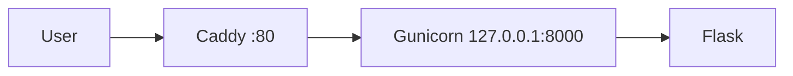

# Manajemen Affiliate Multi-Platform Berbasis Cloud

Cloud Computing - PTI 2802
Pertemuan 3 - Project Inception dan First VPS Deployment

## Author
Putri Umrotul Mamuroh / NIM 25832071009

## Problem
Individu yang menjalankan aktivitas affiliate di beberapa platform dan bekerja sama dengan beberapa brand mengelola brief, ide dan naskah konten, jadwal publikasi, kewajiban kerja sama, dan fee secara terpisah. Ini hipotesis awal yang masih perlu divalidasi lewat wawancara pelaku affiliate.

## Target Users
Individu affiliate multi-platform yang bekerja sama dengan beberapa brand.

## Features M03
- baseline application (halaman awal dengan tautan Health Endpoint dan API Info)
- health endpoint `GET /health`
- deployment pertama di VPS

## Architecture

## Infrastructure
- Ubuntu Server 24.04.5 LTS
- paket VPS 2 vCPU / 2 GB RAM / 20 GB disk (batas desain praktikum: 1 vCPU / 1 GB / 20 GB)
- Caddy sebagai reverse proxy
- Gunicorn dikelola systemd (service `cc-m03`)
- Flask

## Public Endpoint
`http://103.171.85.139/` (sementara, belum memakai domain)

## Health Check
`GET /health`

## Deployment
Lihat `docs/deployment.md`.

## Documentation
- `docs/requirements.md`
- `docs/architecture.md`
- `docs/deployment.md`
- `docs/adr/` (ADR-0001 sampai ADR-0005)
- `docs/evidence/m03/`

## Security
- SSH hanya dengan key (password dan login root dinonaktifkan)
- UFW aktif, hanya port 22 dan 80 yang terbuka
- backend hanya listen di 127.0.0.1:8000
- tidak ada secret di repository

## Current Limitations
- hanya HTTP, belum ada HTTPS
- belum ada database persisten
- belum memakai container
- deployment manual
- satu VPS (single point of failure)

## Roadmap
M04 DNS dan HTTPS, M05 Data dan backup, M06 Container, M07 IaC, M09 CI/CD
