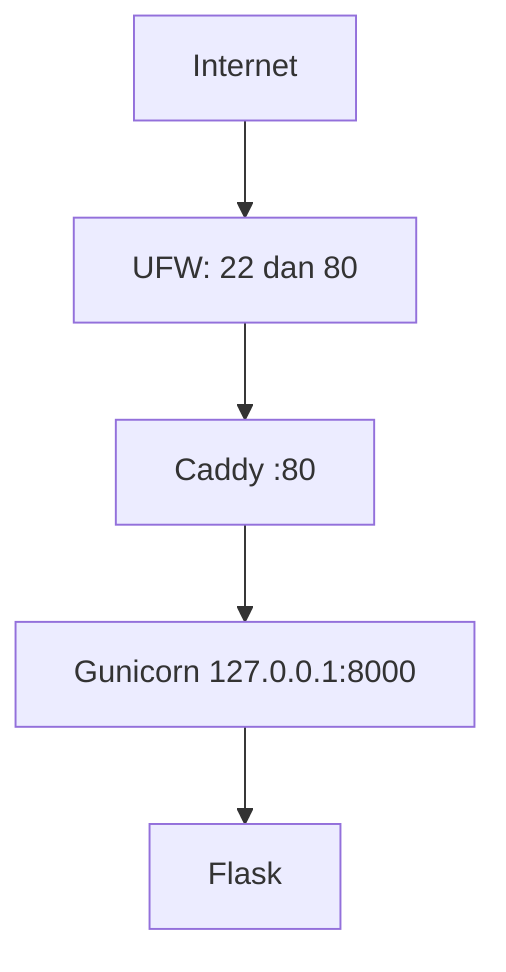

# Architecture v0.1

## Deployment View

## Request Flow
1. Klien mengakses http://103.171.85.139/ pada port 80.
2. UFW hanya mengizinkan port 22 (SSH) dan 80 (HTTP).
3. Caddy menerima permintaan dan meneruskannya ke 127.0.0.1:8000 (reverse proxy).
4. Gunicorn (service systemd cc-m03) menjalankan aplikasi Flask.

## Resource Constraints
- batas desain praktikum: 1 vCPU, 1 GB RAM, 20 GB disk
- VM aktual: 2 vCPU, 1,9 GiB RAM, 19 GB disk (nproc, free -h, df -h)
- pemakaian saat idle: RAM 396 MiB, disk 3,7 GB (21%)

## Security Decisions
- administrasi dengan user non-root (irtup)
- SSH memakai key (Ed25519)
- login password SSH dinonaktifkan
- login root SSH dinonaktifkan
- UFW aktif, hanya port 22 dan 80
- backend hanya listen di 127.0.0.1:8000 (loopback-only)
- tidak ada secret di repository (.env tidak di-commit)

## Current Limitations
- hanya HTTP, belum ada HTTPS
- satu VPS (single point of failure)
- belum ada database
- belum memakai container
- belum ada CI/CD

## Planned Evolution
- M04 DNS dan HTTPS
- M05 data persisten dan backup
- M06 container
- M07 IaC
- M09 CI/CD

## Architecture Decision Records
- docs/adr/0001-vps-self-managed.md
- docs/adr/0002-caddy-https-ufw.md
- docs/adr/0003-sqlite-backup-tanpa-unggah.md
- docs/adr/0004-container-network-image-policy.md
- docs/adr/0005-cost-and-monitoring.md
